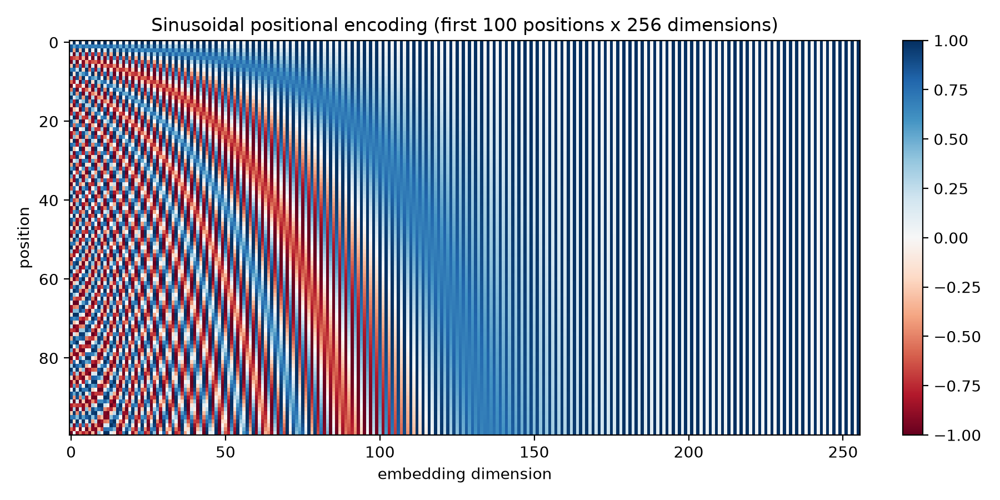
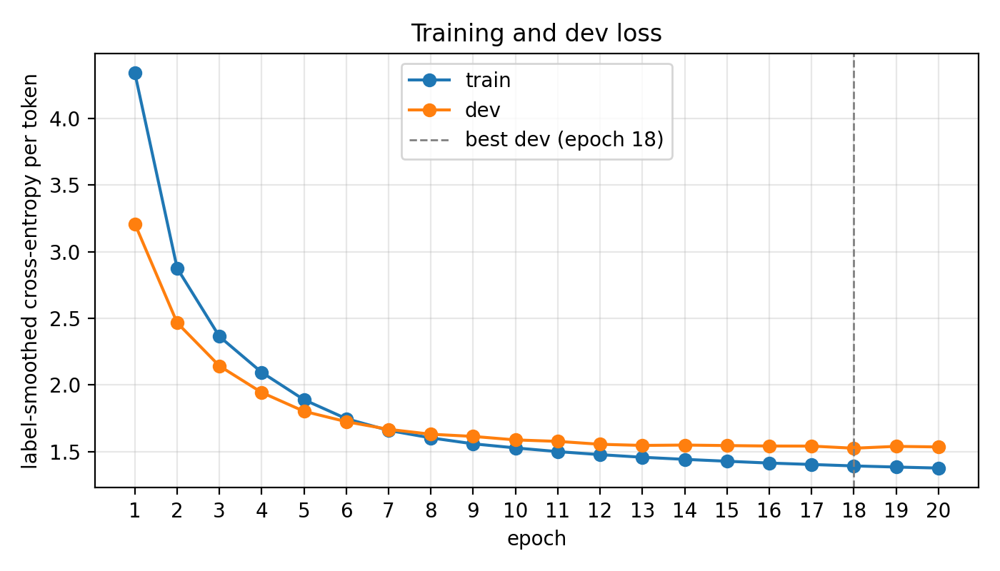
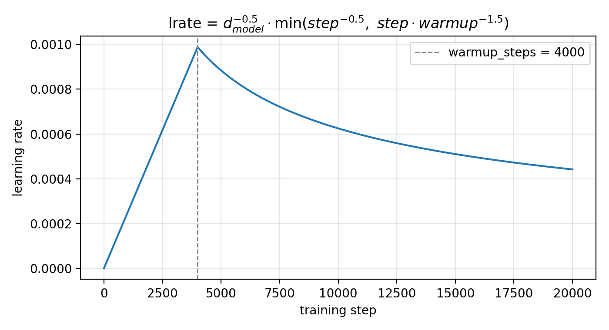
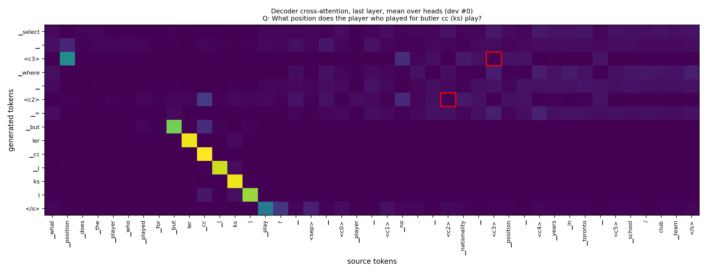
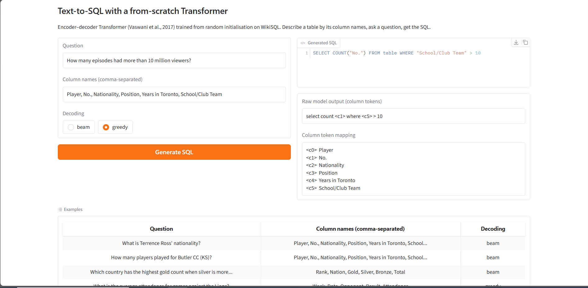

# Text-to-SQL with a From-Scratch Transformer (WikiSQL)

An English question and the column names of a table go in; a SQL query over that table comes out.
The model is the original encoder–decoder Transformer of *Attention Is All You Need* (Vaswani et al., 2017),
written from basic PyTorch layers, trained **once from random initialisation** on
[WikiSQL](https://github.com/salesforce/WikiSQL), and scored with WikiSQL's **official evaluator** by executing
the generated queries on the real tables. Dev and test tables are never seen during training.

```
Question   What is Terrence Ross' nationality?
Columns    Player, No., Nationality, Position, Years in Toronto, School/Club Team
Model      select <c2> where <c0> = terrence ross
SQL        SELECT "Nationality" FROM table WHERE "Player" = 'terrence ross'
```

**Medium blog:** [I Built a Transformer From Scratch That Turns Plain English Into SQL]
(https://medium.com/@hassantahir318/i-built-a-transformer-from-scratch-that-turns-plain-english-into-sql-e0cacd34acc0) · 
**LinkedIn post:** (https://www.linkedin.com/in/muhammad-hassan-tahir-ba2a94220/)
---

## Headline results

| | Logical form | Execution | Parse failures |
|---|---|---|---|
| **Test (beam 4)** | **46.82%** | **54.00%** | **0.17%** |
| Dev (beam 4) | 48.09% | 55.08% | 0.27% |

- **+18 points execution accuracy over the LSTM seq2seq baseline** of the WikiSQL paper (35.9% test), with the same
  plain sequence-to-sequence framing: no pointer network, no reinforcement learning, no pretrained weights.
- Within ~5 points of **Seq2SQL** (59.4% test execution), which adds a pointer network, a structured
  SELECT/aggregation/WHERE decoder and policy-gradient training.
- **7.58 M parameters, 11.9 minutes** of training on one Tesla T4.
- **6/6 correctness checks pass** on the trained model, including a gold round-trip through the official
  evaluator at 99.96%, which shows the tokenisation and parsing pipeline is close to lossless.

---

## Results

### Table 1 – Data

| | Train | Dev | Test |
|---|---|---|---|
| Pairs | 56,355 | 8,421 | 15,878 |
| Mean / max source length (tokens) | 42.5 / 222 | 42.5 / 167 | 42.7 / 260 |
| Mean / max target length (tokens) | 14.8 / 65 | 14.8 / 44 | 14.9 / 46 |
| Pairs dropped as too long | 19 | – | – |

Lengths are SentencePiece tokens as fed to the model: the source includes `</s>`, the target `<s>` and `</s>`.
Dev and test keep every row so that predictions align line by line with the official files.

### Table 2 – Model and training

| | |
|---|---|
| Trainable parameters | 7,577,600 |
| Epochs trained / best epoch | 20 / 18 |
| Best dev loss | 1.5245 |
| Training time and GPU | 11.9 min on Tesla T4 (≈36 s per epoch, 17,620 steps) |

### Table 3 – Official metrics

| Split | Decoding | Logical form (%) | Execution (%) | Parse failures (%) |
|---|---|---|---|---|
| Dev | greedy | 47.76 | 54.72 | 0.29 |
| Dev | beam (4) | 48.09 | 55.08 | 0.27 |
| Test | beam (4) | 46.82 | 54.00 | 0.17 |

Beam search was chosen as the final decoding because it has the higher **dev** execution accuracy; the test set
was then decoded exactly once.

### Table 4 – Component accuracy (dev, beam)

| | |
|---|---|
| `sel` column correct (%) | 76.08 |
| `agg` correct (%) | 89.55 |
| WHERE clause correct (%) | 60.82 |

### Figures

| | |
|---|---|
|  |  |
| Sinusoidal positional encoding, 100 positions × 256 dimensions | Train and dev loss per epoch |
|  |  |
| Learning-rate schedule, first 20,000 steps | Last-layer decoder cross-attention, mean over heads |

Qualitative samples (five correct, five wrong, each failure named): [`results/samples.md`](results/samples.md).

---

## What the numbers say

**Training is healthy and well regularised.** Dev loss falls from 3.21 to 1.52 and dev token accuracy rises to
92.6%. Label smoothing (ε = 0.1 over 8,000 tokens) puts a floor of about 1.2 under the loss even for a perfect
model, so 1.52 is close to the achievable minimum. Train and dev loss separate only after epoch ~15, and the
lowest-dev-loss checkpoint (epoch 18) is the one evaluated.

**Token accuracy is not query accuracy.** 92.6% teacher-forced token accuracy turns into 48% exact logical forms:
a query is about 14 tokens long, the model has to get all of them right on its own, and one early mistake changes
everything after it.

**Execution beats logical form by ~7 points.** Different queries can return the same answer: a `COUNT` over a
different column, or a condition that does not change the result. Logical form is the strict measure; execution is
what a user experiences.

**The WHERE clause is the bottleneck (60.8%).** Column selection and aggregation are classification-like
decisions over a handful of options; the WHERE value has to be regenerated sub-word by sub-word from the
vocabulary. The model has no copy mechanism, so names and numbers that are rare in training are where it fails
most. This is exactly the gap that pointer/copy networks close in later WikiSQL work.

**Aggregation is near the dataset ceiling (89.6%).** WikiSQL's aggregation labels are known to be noisy
(e.g. "how many" annotated both as `COUNT` and as a plain select of a number column), and published models
plateau around 90% on this component.

**Column selection (76.1%) is the clearest room for improvement.** Errors concentrate on tables with similar
column names (`Gold` vs `Total`, `Date` vs `Original air date`).

**Beam search helps only slightly (+0.36 EX).** Outputs are short and the model is confident, so the greedy path
is usually already the best one. The length penalty (α = 0.6, as in the paper) keeps beam search from preferring
truncated queries.

**Dev and test agree (55.08% vs 54.00%).** The 1-point gap is what you expect from tables the model has never
seen; nothing leaks from gold data into predictions (the doc's warning threshold is 95%).

**Attention does not simply point at the column.** For the generated `<cK>` tokens, the last decoder layer's
cross-attention (averaged over heads) peaks on a piece of column K only 3.17% of the time (66 of 2,079 column
tokens in the first 1,000 dev examples), even though column selection is correct 76% of the time. The heat-map
should therefore not be read as "the model looks at the column it writes". Plausible explanations are that the
matching between question words and columns is already resolved in the encoder representations, that the peak
lands on the question word that names the column, or that the averaged last layer acts as an aggregator over
positions such as `</s>`. This is consistent with *Attention is not Explanation* (Jain & Wallace, 2019): attention
weights are suggestive, not proof of what drives a prediction.
<!-- After running the per-layer diagnostic, replace the "plausible explanations" sentence with the measured
     distribution (question / column / </s> / <sep>) for layers 1-3. -->

---

## Correctness checks

Output of `python checks.py` on the trained checkpoint (eval mode, tolerance 1e-5, first 8 dev examples):

- **Causal mask:** PASS. Changing the last decoder input token: max |Δ| at earlier positions = 0.00e+00
  (at the changed position itself: 1.17e+01).
- **Padding mask:** PASS. Appending 25 `<pad>` tokens to every source: max |Δ| of the output logits = 0.00e+00.
- **Attention rows sum to 1:** PASS. Over all 9 attention modules, max |row sum over unmasked keys − 1| = 2.98e-07;
  max weight on a masked key = 0.00e+00.
- **Weight sharing:** PASS. `model.generator.weight is model.shared.emb.weight` → True; encoder and decoder
  InputLayers hold the same TokenEmbedding → True. Trainable parameters: 7,577,600.
- **Learning rate:** PASS. Peak 9.882e-04 at step 4000; linear rise for steps 1–4000 and step^-0.5 decay for
  steps 4001–20000, both exact to ~2e-16.
- **Gold round-trip:** PASS. Official evaluator on parsed gold dev targets: execution 99.96%, logical form 99.96%,
  parse failures 0.00%.

---

## Implementation

**Model (Task 2).** d_model 256, 4 heads (d_k = d_v = 64), 3 encoder + 3 decoder layers, d_ff 1024, dropout 0.1,
post-norm `LayerNorm(x + Dropout(Sublayer(x)))`. One `TokenEmbedding` instance feeds the encoder `InputLayer`, the
decoder `InputLayer` and, through `generator.weight = shared.emb.weight`, the output projection.
Parameter breakdown: embedding 2,048,000 · encoder 2,369,280 · decoder 3,160,320, with no output bias.
Masks are boolean (True = may attend). Masked scores are filled with the most negative finite value of the score
dtype, which acts as −∞ after softmax (masked weights are exactly 0) but can never produce NaN and stays valid in
fp16. Embeddings are initialised N(0, d_model^-0.5) so that after the √d_model scaling they have unit variance,
like the positional encodings; all other matrices use Xavier-uniform.

**Training (Task 3).** Teacher forcing (`tgt[:, :-1]` → `tgt[:, 1:]`), cross-entropy with label smoothing 0.1
ignoring `<pad>`, Adam (β = 0.9, 0.98, ε = 1e-9), the paper's learning-rate schedule with 4,000 warm-up steps
applied every batch, batch size 64, 20 epochs, fp16 autocast on GPU with the loss computed in fp32. Train loss,
dev loss and learning rate are logged after every epoch (`results/train_log.csv`); only the lowest-dev-loss
checkpoint is kept. The test set is never loaded during training.

**Decoding (Task 4).** Batched greedy decoding and beam search (beam 4, length penalty α = 0.6 from Sec. 6.1 of the
paper), both stopping at `</s>` or 64 tokens. Two decoding-time rules use only the model input, never gold data:

- *Validity mask.* `<pad>`, `<s>`, `<sep>` and column tokens `<cK>` with K ≥ number of columns are excluded before
  the arg-max / top-k. A query naming a non-existent column cannot run, and the column count is known at inference
  time (the front end gets it from the user's column list). This keeps parse failures below 0.3%.
- *`<unk>` repair.* Characters never seen in training (Hebrew, Arabic, rare CJK) become `<unk>`. WHERE values are
  copied from the question, so the parser rebuilds them by matching the known pieces around each `<unk>` against
  the question. This raises the gold round-trip ceiling from 99.49% to 99.96% execution accuracy.

The parser turns the decoded string into WikiSQL's `{"sel", "agg", "conds"}` format, splitting conditions only on
`and <cK>` because values may contain the word "and". It writes exactly one line per example in file order and
`{"error": "parse"}` when the string is not a valid query. `to_readable_sql` restores the real column names.

**Evaluation (Task 5).** `evaluate_model.py dev` decodes dev with both strategies, runs the unmodified official
evaluator, computes component accuracy (`sel`, `agg`, WHERE as a set of conditions), picks the final decoding by
dev execution accuracy, draws the attention map and writes the qualitative samples. `evaluate_model.py test`
refuses to run before that choice exists and refuses to run a second time, so the test set is used once.

---

## Front end

```bash
python app/app.py            # http://127.0.0.1:7860   (add --share on Colab/Kaggle)
```

Type a question and a comma-separated list of column names; the app calls the trained checkpoint and shows the SQL
with the real column names, the raw model output and the column-token mapping.



---

## Repository layout

```
starter/                 the given starter files, unchanged (verified by scripts/starter.sha256)
model/attention.py       ScaledDotProductAttention, MultiHeadAttention
model/layers.py          PositionwiseFeedForward, EncoderLayer, DecoderLayer
model/transformer.py     masks (padding, causal), Encoder, Decoder, Transformer with 3-way weight sharing
train.py                 Task 3: teacher forcing, label smoothing, Adam + warm-up schedule, best-dev checkpoint
decode.py                Task 4: greedy, beam search (k=4), parser -> WikiSQL dict, readable SQL
evaluate_model.py        Task 5: prediction files, official evaluator, component accuracy, attention map, samples, tables
data_report.py           Task 1.3–1.4: Table 1, starter shapes, positional-encoding heat-map
checks.py                correctness checks -> results/correctness_checks.md
common.py                paths, fixed hyper-parameters, shared helpers
app/app.py               Task 6.1: Gradio front end
results/                 prediction files, metrics.json, tables.md, figures/, samples.md, train_log.csv
checkpoints/best.pt      trained model (lowest dev loss, epoch 18)
notebooks/               one-click GPU run for Kaggle / Colab
scripts/                 data setup, full pipeline, compliance check
docs/                    viva notes, blog and LinkedIn drafts
```

---

## How to run

Tested with Python 3.11–3.13 and PyTorch 2.x.

```bash
pip install -r requirements.txt
bash scripts/setup_data.sh                      # clone WikiSQL, extract the data, link it into starter/

cd starter && python data_prep.py && python tokenizer.py && python check_starter.py && cd ..
python data_report.py                           # Table 1 + positional-encoding heat-map
python checks.py                                # correctness checks
python train.py                                 # 20 epochs (~12 min on a T4)
python evaluate_model.py dev                    # greedy + beam on dev, components, attention, samples
python evaluate_model.py test                   # test, exactly once, with the decoding chosen on dev
python evaluate_model.py report                 # rebuild results/tables.md
python app/app.py                               # front end
```

`notebooks/train_on_gpu.ipynb` runs the whole pipeline on Kaggle or Colab. The official evaluator can also be called
by hand exactly as in the assignment:

```bash
cd WikiSQL && python evaluate.py data/dev.jsonl data/dev.db ../results/dev_beam.jsonl
```

**Windows notes.** Set `$env:PYTHONUTF8 = "1"` before running the evaluator by hand. Cloning WikiSQL fails on
Windows because of a macOS `Icon\r` file in the repository; download `data.tar.bz2`, `evaluate.py` and `lib/` with
`curl` from `raw.githubusercontent.com/salesforce/WikiSQL/HEAD/` instead, then extract the data.

---

## Constraints

- No `nn.Transformer*`, `nn.MultiheadAttention`, `F.scaled_dot_product_attention`, Hugging Face `transformers` or
  pretrained weights anywhere. `bash scripts/check_compliance.sh` scans the code and verifies that `starter/` is
  byte-identical to the given files.
- The dev set is used only to choose the checkpoint and the decoding strategy; the test set is decoded once.

---

## Limitations and next steps

- **No copy mechanism.** WHERE values are regenerated from the vocabulary, which is the largest error source
  (60.8% WHERE accuracy). A pointer/copy layer over the question (Vinyals et al., 2015; Gu et al., 2016) is the most
  direct improvement.
- **Order-sensitive targets.** Conditions are generated in a fixed order although WikiSQL treats them as a set;
  sketch-based decoders (SQLNet) avoid this.
- **Single-table SQL only.** WikiSQL has no joins, nesting or GROUP BY; Spider is the natural next benchmark.
- **Pretraining.** Models with pretrained encoders (SQLova, X-SQL) exceed 90% execution accuracy on WikiSQL; this
  project deliberately trains from scratch to study the architecture itself.

---

## Author

Hassan ([@MeMorphLing](https://github.com/MeMorphLing))

## References

- Vaswani et al. (2017). *Attention Is All You Need*. arXiv:1706.03762
- Zhong, Xiong & Socher (2017). *Seq2SQL: Generating Structured Queries from Natural Language using Reinforcement
  Learning* (WikiSQL). arXiv:1709.00103
- Kudo & Richardson (2018). *SentencePiece*. arXiv:1808.06226
- Wu et al. (2016). *Google's Neural Machine Translation System* (length penalty). arXiv:1609.08144
- Press & Wolf (2017). *Using the Output Embedding to Improve Language Models*. arXiv:1608.05859
- Vinyals et al. (2015). *Pointer Networks*. arXiv:1506.03134 · Gu et al. (2016). *CopyNet*. arXiv:1603.06393
- Xu et al. (2017). *SQLNet*. arXiv:1711.04436 · Hwang et al. (2019). *SQLova*. arXiv:1902.01069
- Jain & Wallace (2019). *Attention is not Explanation*. arXiv:1902.10186
